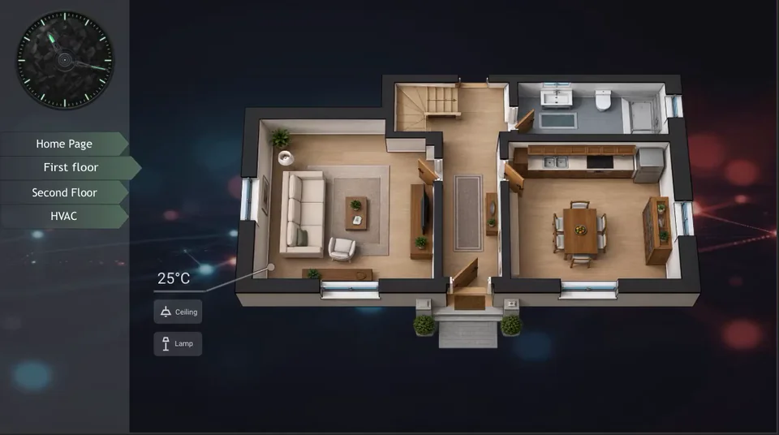
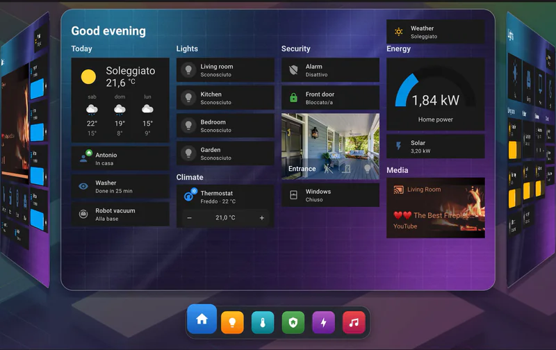
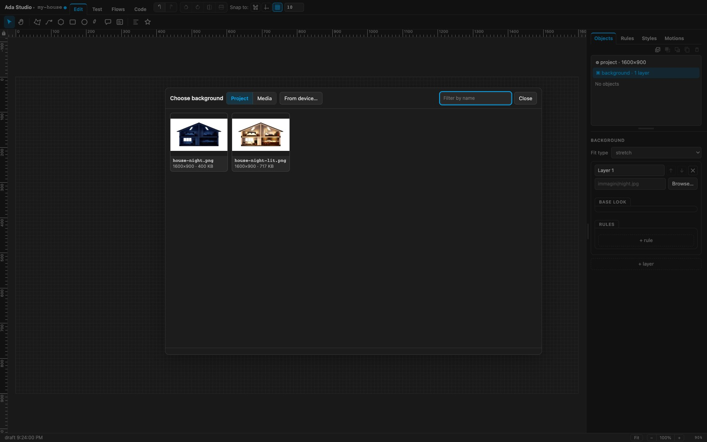
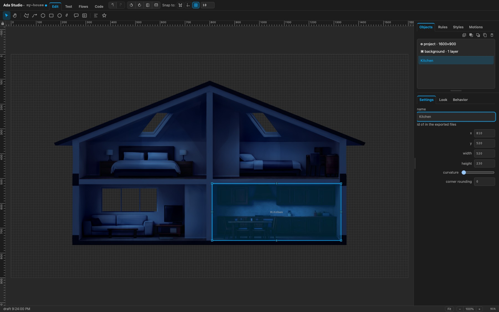
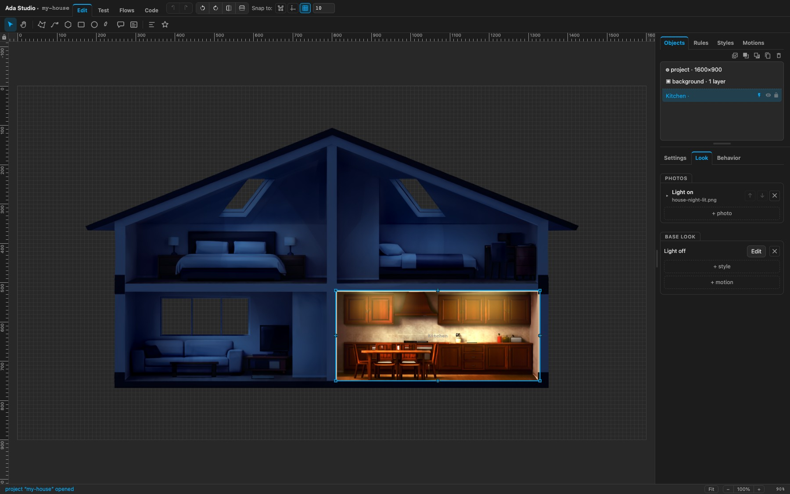
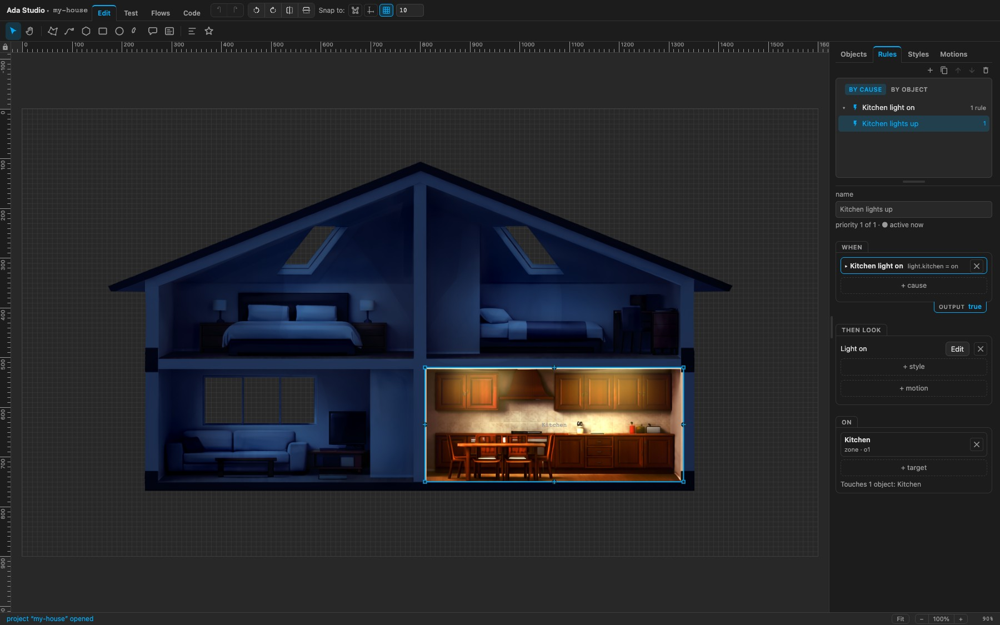
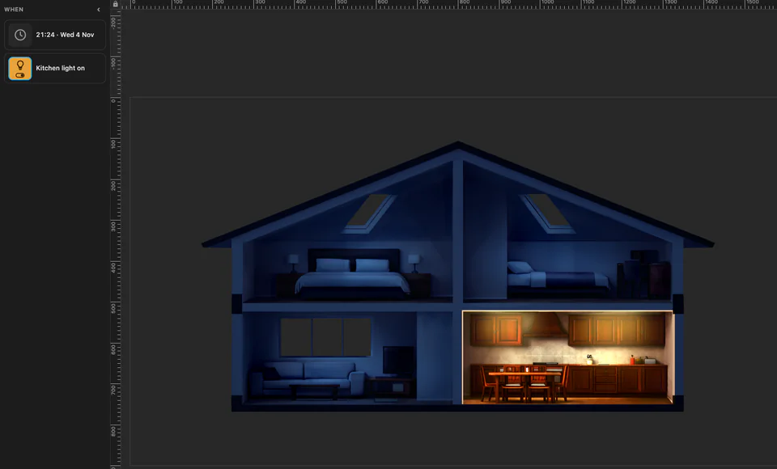
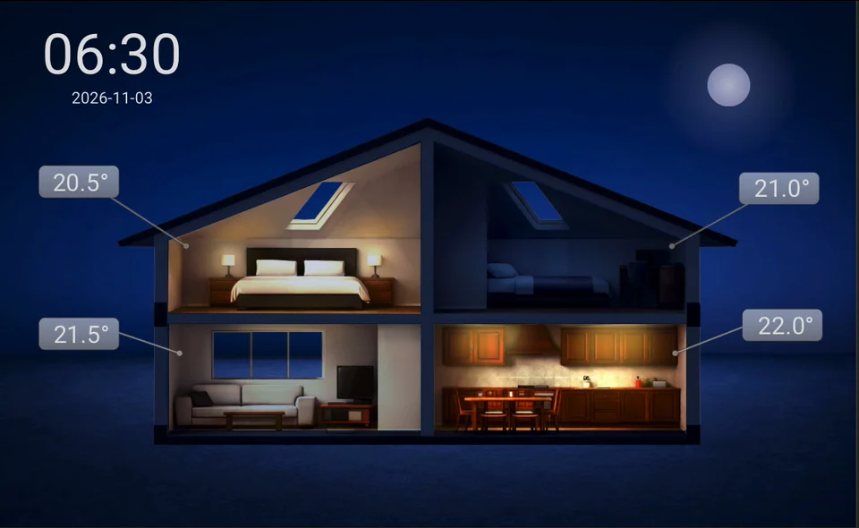

# Ada Studio

*Advanced Dashboard Animator*

**Draw your Home Assistant dashboard instead of stacking cards.**

Ada Studio was born to make dashboards easier to create, to manage and to bring to life. It is a graphical editor in the Home Assistant sidebar: you start from any picture, draw zones on it, and decide how each one looks and moves as your entities change. No YAML to write, no CSS to learn: Ada Studio writes it all for you.



---

## Your own graphics and Home Assistant cards, together

Zones, photos and animations live side by side with the cards you already use. Any Lovelace card, built-in or custom, can sit anywhere on the picture, take the same styles and follow the same rules, and stays live while the pages turn.

This dashboard is the example that comes with Ada Studio: six pages of Home Assistant cards on a drawn background, turning like a carousel under your finger, with a menu bar that follows the open page.



## Open dashboards made by others

A project can use **placeholder entities** instead of real ones: they behave like a light, a sensor or a thermostat, so the whole dashboard works in Ada Studio even in a house that does not have those devices. That is how the example above travels: open it from *Open project…*, try it in **Test**, then link each placeholder to one of your entities from the *Entities…* window, and the dashboard is yours.

It also works the other way round: *Make placeholders* turns your entities into generic placeholders, so you can share a dashboard without sharing your home.

---

## Your first zone

### 1. Choose a picture

Create a project, select **background** and pick an image from the project folder, from Home Assistant **Media**, or upload it from your device.



### 2. Draw a zone

Pick the polygon tool and click around the room; **Enter** closes the shape. Give it a name: names show up everywhere.



### 3. Give it a look

In **Look**, add a photo of the same room with the light on, and a style for its base look: here *Light off*, which hides it.



### 4. Add a rule

In **Behavior**, a rule reads **When → Then → On**: *when* the kitchen light is on, *then* apply the *Light on* look, *on* the kitchen.



### 5. Try it

In **Test** you switch the light from the side bar and the picture reacts exactly as the dashboard will, without touching your devices. Then *Create dashboard* in the title menu puts it in your sidebar.



---

## How it works

Ada Studio is the **editor**, not the dashboard. Each time you choose *Update dashboard*, it writes these files into the project folder:

| File | Content |
| --- | --- |
| `panel.svg` | the geometry: zones, labels, icons, cards |
| `panel.css` | the look: styles, photos, animations |
| `panel-config.yaml` | the ha-floorplan configuration: images, stylesheet, rules, tap actions |
| `panel.yaml` | the three-line card that shows the project on a dashboard |

On your dashboard, [ha-floorplan](https://github.com/ExperienceLovelace/ha-floorplan) reads those files and animates them with the states of your entities. Because the dashboard only reads the exported files, you can keep editing: after each *Update dashboard* you just reload the dashboard.

---

## Installation

> Ada Studio is in **beta**. Please report bugs and ideas in the [issues](https://github.com/ada-studio-ha/ada-studio/issues), or write to [antartix26@gmail.com](mailto:antartix26@gmail.com).

**Requirements**

- Home Assistant (current stable release)
- [ha-floorplan](https://github.com/ExperienceLovelace/ha-floorplan), installed from the Marketplace
- an administrator account (the panel and all its commands are admin-only)

**Install from the Marketplace** (recommended)

[](https://my.home-assistant.io/redirect/marketplace_repository/?owner=ada-studio-ha&repository=ada-studio&category=integration)

1. Select the button above. Or go to **Settings → Marketplace**, select **Add from link**, enter `ada-studio-ha/ada-studio` and select **Ada Studio** in the list. The first time, the Marketplace asks you to connect a (free) GitHub account: open the GitHub link in another tab, so the code stays on screen.
2. Select **Install**.
3. The setup opens by itself: select **Submit**. **Ada Studio** appears in the sidebar.

New releases then appear in **Settings → Updates**.

On Home Assistant before 2026.11 the button opens **HACS**: select **Download**, restart Home Assistant, then add **Ada Studio** from **Settings → Devices & services → Add integration**.

**Or install manually**

1. Download the [latest release](https://github.com/ada-studio-ha/ada-studio/releases) and copy its `custom_components/ada_studio/` folder into your `config/custom_components/`.
2. Restart Home Assistant.
3. Go to **Settings → Devices & services → Add integration**, search for **Ada Studio** and select **Submit**. **Ada Studio** appears in the sidebar.

To change where projects are stored, or the sidebar title and icon, select **Configure** on the Ada Studio integration.

**Guides:** [Your first project](docs/guide/first-project.md) · [Rules, styles and Motion](docs/guide/rules-styles-motion.md) · [Flows, Test and pages](docs/guide/flows-test-pages.md)

<details>
<summary>Prefer to place the card yourself?</summary>

Choose *Update dashboard*, then on any dashboard add a card with **Manual** and paste the three lines of `panel.yaml`:

```yaml
type: custom:floorplan-card
full_height: true
config: /local/ada_studio/<project>/panel-config.yaml
```

Set that view to **Panel** so the picture fills the screen.
</details>

---

## Advanced examples

A house in cross-section through a whole day: the sky, the sun and the lights of the rooms follow the time.



---

## Feedback and contact

- **Bugs and ideas**: open an [issue](https://github.com/ada-studio-ha/ada-studio/issues/new/choose); the form asks for the versions that help find the problem.
- **Anything else**, or what you prefer not to post publicly: [antartix26@gmail.com](mailto:antartix26@gmail.com).

---

## License

Copyright © 2026 Antonio Arnone. Ada Studio is free software, released under the [GNU Affero General Public License v3.0](LICENSE): you can use, modify and share it, also for work; if you distribute a modified version, or offer it as a network service, you must release its source code under the same license.

<sub>Animations: real dashboards made with Ada Studio. Screenshots: the Home Assistant dark theme, with a demo project.</sub>
