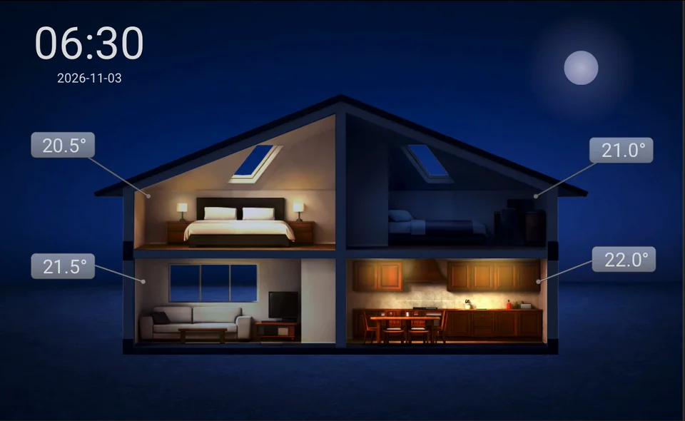
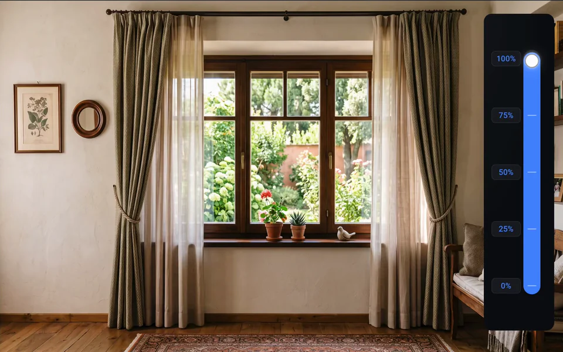
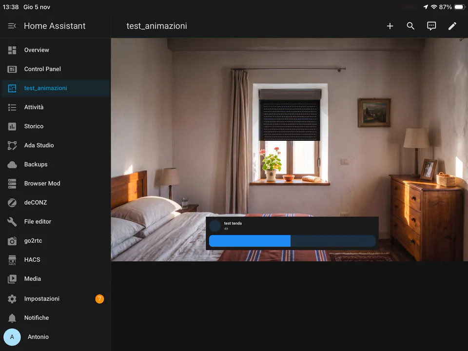
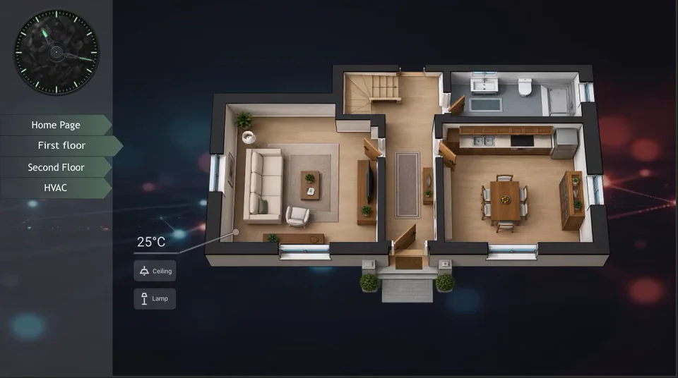
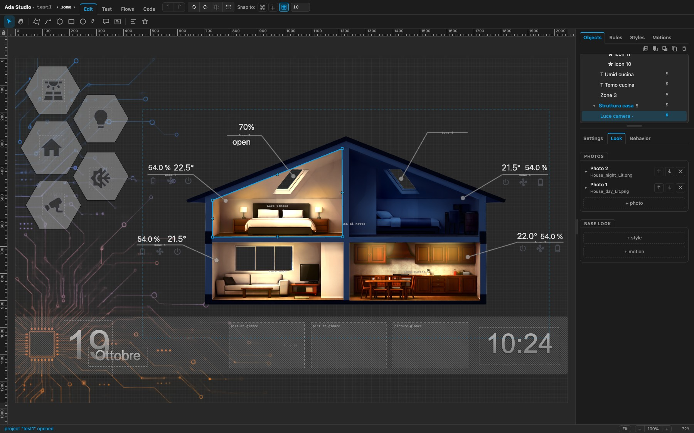
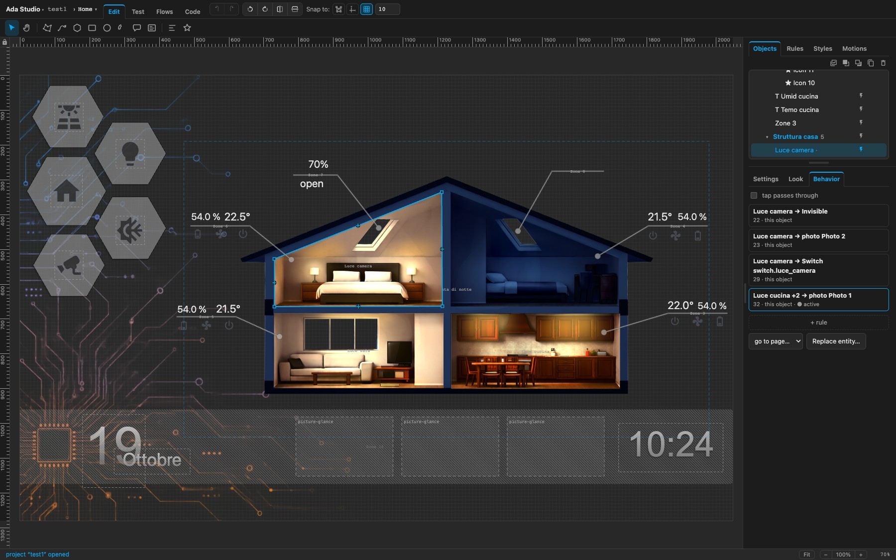
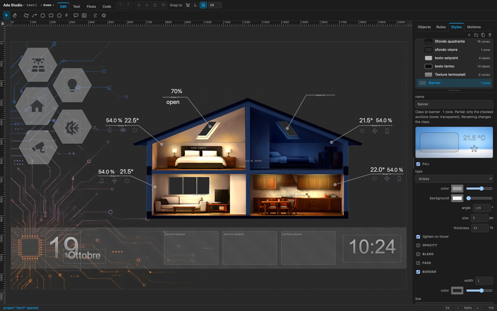
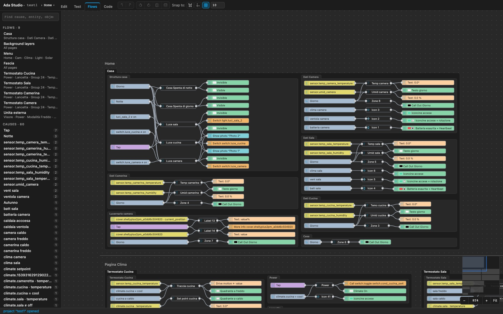
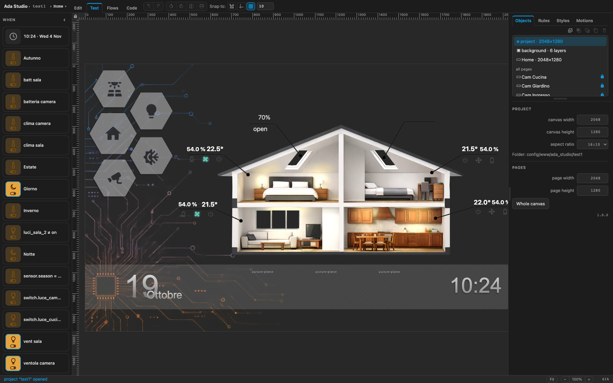
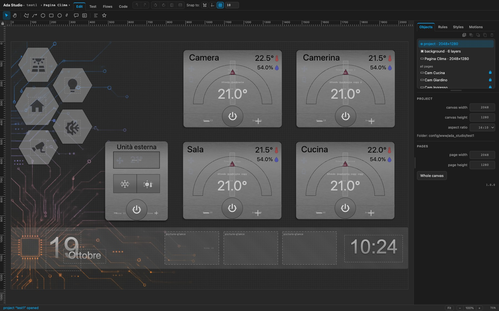

# Ada Studio

*Advanced Dashboard Animator*

**Draw your Home Assistant dashboard instead of stacking cards.**

Ada Studio is a Home Assistant integration that adds a graphical editor to the sidebar. You take a picture (a photo of your house, a floor plan, a render, any artwork), draw **free-form zones** on top of it, and decide how each zone looks and behaves as your entities change. Ada Studio then writes everything the [ha-floorplan](https://github.com/ExperienceLovelace/ha-floorplan) card needs to bring it to life on your dashboard.



<table>
<tr>
<td></td>
<td></td>
</tr>
<tr>
<td align="center"><sub>Curtains following a slider</sub></td>
<td align="center"><sub>A roller shutter and the light in the room</sub></td>
</tr>
</table>



The typical use: a photo of the house with the lights off as the background, and for each room a zone that fades in the photo of the same room lit up when its light turns on, with an opacity that follows the brightness. From there you can go much further: thermostats, menus, multiple pages, Home Assistant cards placed anywhere on the picture.

---

## Highlights

- **A real drawing tool, inside Home Assistant.** Polygons, curves, rectangles, circles, sectors, regular polygons, callouts, open lines with arrows, labels and Material Design icons. Rulers, guides, grid and snapping, groups, locks, undo/redo, multi-select, rotate and flip. It works with a mouse or a touchscreen (pinch to zoom, two fingers to pan), so you can also edit from a tablet.
- **Photos per zone.** Each zone can show one or more photos clipped to its shape. A photo can be anchored to the canvas or follow the shape, and its opacity, blend mode and transition come from styles.
- **Styles you reuse.** Solid colours, linear, radial and conic gradients, stripes and other patterns, tiled textures, strokes, glows, opacity and blend modes. Styles are named, grouped, previewed, and they can apply to a single object, a group or the whole canvas.
- **Rules: When → Then → On.** Everything that changes at runtime is a rule: *when* some conditions are true (AND/OR), *then* apply a look, show a photo, write a value or play an animation, *on* these objects or groups. A rule can also make a photo follow a value, a label show a sensor reading, or an icon change.
- **Tap actions.** Toggle an entity, open its *More info* dialog, call any service, go to another page, or apply a style locally. Zones can also let taps pass through to what is underneath.
- **Animations.** Spin, pulse, blink, heartbeat, shake, bounce, fade or your own keyframes, dashes flowing along a line, and properties driven straight by an entity value (for example a gauge needle rotated by the setpoint).
- **Pages.** One project can hold several pages (home, climate, lights, cameras…) sharing a background and common objects, with navigation between them.
- **Home Assistant cards on the canvas.** Place any Lovelace card, built-in or custom, on the picture, either from YAML or by picking it from an existing dashboard, and style it with the same rules.
- **Flows: all the logic at a glance.** A node canvas lists every cause, the objects it drives and the effects, grouped the way your objects are grouped.
- **Test.** Simulate entity values and the time of day to check how every rule reacts, without touching your devices.
- **Projects live in your config folder.** Each project is a folder under `www/ada_studio/`, saved with conflict detection between devices, included in Home Assistant backups, and easy to copy or duplicate.

---

## A tour

### Draw and dress the zones

Select a zone to edit its geometry (*Settings*), its photos and base look (*Look*) and the rules that act on it (*Behavior*). Here the bedroom zone holds two photos: the lit room by night and by day.



### Give them a behaviour

The *Behavior* tab lists every rule that touches the selected object. The rule that is currently true is marked *active*. New rules start from **+ rule**, and *Replace entity…* swaps an entity across all the rules of a selection, which is handy after copying a room.



### Build a style library

Styles are listed with how many objects use them, grouped as you like, and previewed live. The same style can be the base look of a zone or the effect of a rule.



### See the logic as flows

**Flows** turns the whole project into a readable graph: causes on the left (entities, sun, taps), the objects they drive in the middle, the effects on the right. Pick a cause to follow its chain, drag a cause onto an object to create a rule, and jump to any group from the list.



### Test before you publish

**Test** shows every cause of the project in a side bar: flip a light, move a value or change the time of day, and the canvas reacts exactly as the dashboard will, without touching your devices.



### Go beyond the floor plan

Zones, labels, icons, animations and rules are enough to build complete control panels. This climate page has four thermostats, each with a needle that follows the setpoint, power and +/− buttons that call services, and live temperature and humidity.



---

## How it works

Ada Studio is the **editor**, not the dashboard. Each time you choose *Update dashboard*, it writes these files into the project folder:

| File | Content |
| --- | --- |
| `panel.svg` | the geometry: zones, labels, icons, cards |
| `panel.css` | the look: styles, photos, animations |
| `panel-config.yaml` | the ha-floorplan configuration: images, stylesheet, rules, tap actions |
| `panel.yaml` | the three-line card that shows the project on a dashboard |

On your dashboard, [ha-floorplan](https://github.com/ExperienceLovelace/ha-floorplan) reads those files and animates them with the states of your entities. Because the dashboard only reads the exported files, you can keep editing: after each *Update dashboard* you just reload the dashboard.

---

## Installation

> Ada Studio is in **beta**. Please report bugs and feedback in the [issues](https://github.com/ada-studio-ha/ada-studio/issues).

**Requirements**

- Home Assistant (current stable release)
- [ha-floorplan](https://github.com/ExperienceLovelace/ha-floorplan), installed from HACS
- an administrator account (the panel and all its commands are admin-only)

**Install**

Download the [latest release](https://github.com/ada-studio-ha/ada-studio/releases) and copy its `custom_components/ada_studio/` folder into your `config/custom_components/`.

**Then**

1. Restart Home Assistant.
2. Go to **Settings → Devices & services → Add integration**, search for **Ada Studio** and select **Submit**. **Ada Studio** appears in the sidebar.

To change where projects are stored, or the sidebar title and icon, select **Configure** on the Ada Studio integration.

## Getting started

1. Open **Ada Studio** from the sidebar and create a project from the title menu (*New project…*).
2. Choose a background image: pick it from the project folder or upload it from your device.
3. Draw your zones, labels and icons, then add styles, photos and rules.
4. Check the result with **Test**.
5. Choose *Create dashboard* from the title menu. Ada Studio writes the files, adds a dashboard named after the project to the sidebar, with a full-screen **Panel** view showing your picture, and opens it. If the dashboard already exists, it just opens it.

From then on, *Update dashboard* followed by a reload is all it takes to publish your changes. When you delete a project, Ada Studio asks whether to delete its dashboard too.

<details>
<summary>Prefer to place the card yourself?</summary>

Choose *Update dashboard*, then on any dashboard add a card with **Manual** and paste the three lines of `panel.yaml`:

```yaml
type: custom:floorplan-card
full_height: true
config: /local/ada_studio/<project>/panel-config.yaml
```

Set that view to **Panel** so the picture fills the screen.
</details>

---

## License

Ada Studio is released under the [PolyForm Shield License 1.0.0](LICENSE): you can use, modify and share it, also for work, but not to build a product or service that competes with Ada Studio.

<sub>Animations: real dashboards made with Ada Studio. Screenshots: the Home Assistant dark theme, with a demo project. Camera cards are shown as placeholders.</sub>
